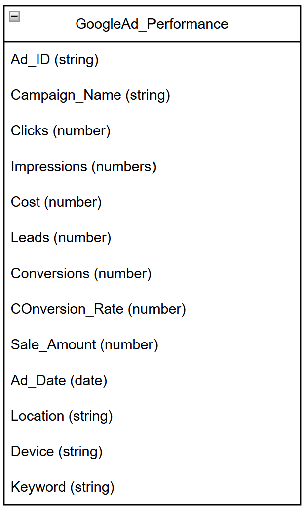
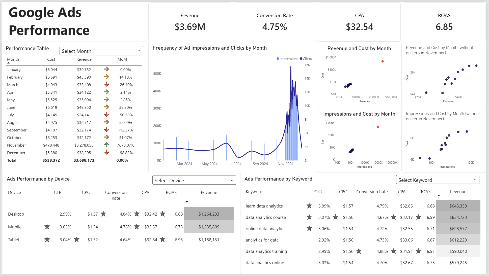
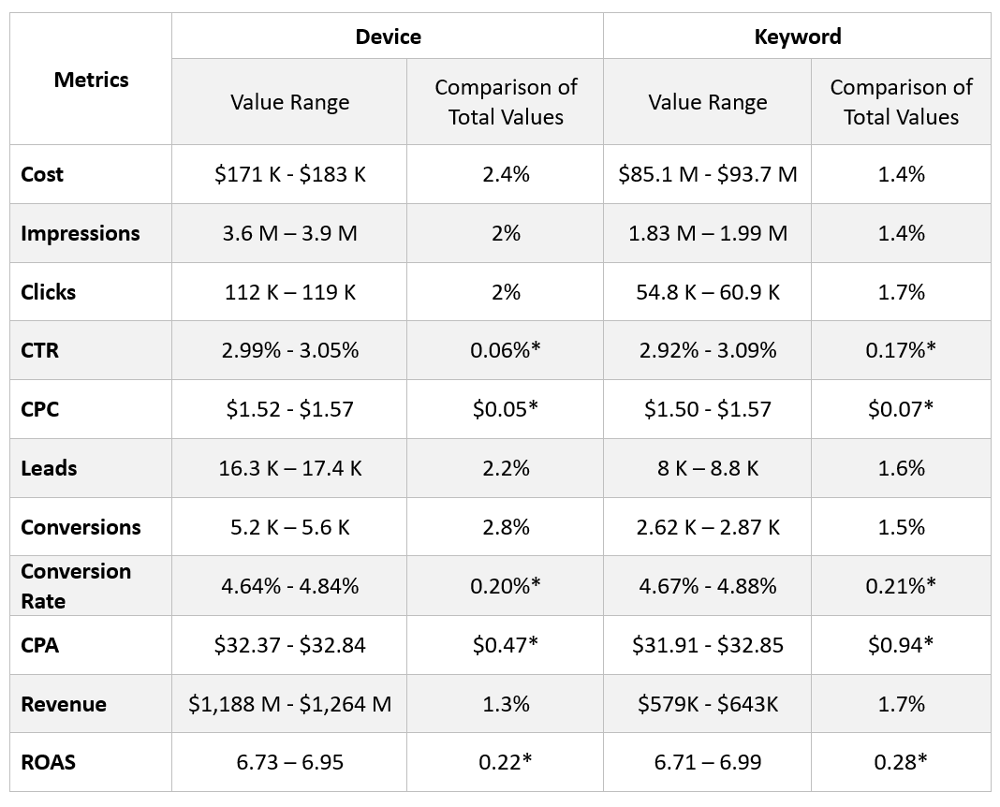

# Google Ads Performance Insights for Media Planning: Data Analytics Course - Hyderabad, 2024

### Project Background

A tech-education company specialising in online training to help people become professionals in the tech and data sectors. Founded in 2019 as a solution for those wishing to take courses but unable to attend face-to-face sessions due to the pandemic.

My role here is as a Marketing Analyst, responsible for evaluating the performance of marketing initiatives to inform the planning of future programmes. The marketing channel currently under evaluation is Google Ads, which has been in use from January to December 2024.

The Marketing Planning division requires insights into the performance of this marketing channel by answering the following questions.
1. How have the adverts performed and what results have they yielded for the company?
2. What steps should be taken to improve the performance of adverts on this channel?
2. Which aspects need to be optimised and evaluated?
3. Is it necessary to increase the advertising budget for this channel?

⚠️Disclaimer: This project does not represent a real-world scenario; it has been created for portfolio purposes.

### Data Structured

Ad performance data from Google Ads is available in a single table containing 13 columns and 2,660 rows. The data structure is as follows.

The raw data and the cleaned data can be viewed [here](https://github.com/CHodes-dev/GoogleAds-Performance-Analysis/blob/main/docs/googleads_performance_2024.xlsx). The data cleaning process is explained in this [file](https://github.com/CHodes-dev/GoogleAds-Performance-Analysis/blob/main/project_workflow/02_cleaning_data.md).

### Executive Summary

#### Overview

The company generated a total of $3.69 million from its marketing efforts on the Google Ads channel, with total costs of $538,372, recording a return on ad spend (ROAS) of 6.85 and a customer acquisition cost of $32.54. This means the company saw a return of up to six times its investment from these marketing efforts. However, it is not yet clear whether the customer acquisition cost remains within a safe range, as the profit margin, which is used as the standard for calculating net profit is unknown.

For a more detailed view of the ad performance, please refer to the dashboard below or download it [here](https://github.com/CHodes-dev/GoogleAds-Performance-Analysis/blob/main/docs/googleads_dashboard.pbix).

The most striking performance in advertising revenue occurred in November and December. In November, there was a very significant increase in revenue of 7,673% from the previous month, reaching $3,278,058. Meanwhile, in the following month, revenue dropped by as much as 99% as only $38,295 was received. However, that month was not the worst. July was recorded as the month with the lowest revenue, amounting to just $24,141.

These three occurrences are also linked to fluctuations in costs incurred during those months. Meanwhile, the amount spent can be attributed to two factors: the frequency and the number of adverts uploaded each month. Following analysis, it appears that an increase in these indicators can boost advertising revenue.

Generally, there are no significant differences in ad performance based on device or keywords. The following metrics can be assessed.

The differences in values across all metrics are less than 3% of the total value and less than $1 for CPC and CPA. In fact, revenue for the device category and keyword usage differ by only 1.3% and 1.7%, respectively, values too small to indicate the best or worst performance. 

The advantage of this small performance ratio is that even a slight improvement in metrics can directly impact ad revenue. 

Based on the findings of the analysis that has been conducted, here are the recommendations that can be proposed for media planning and content strategy.

1. Set a daily budget for ad placements

Ads that appear every day on the search results pages of your target audience are more likely to be clicked and generate conversions than ads that appear only one day a month.  This is important to do to increase revenue from conversions made by the audience.

2. Increase the budget for ad placements

Increasing your budget, particularly by paying a higher cost per click (CPC) under certain conditions can ensure your ads appear at the top of your audience’s search results pages. Here are some keywords for which you might want to increase your budget. 
- '**data analytics training**' (Top 5 keyword)  
This keyword is the most efficient, so increasing the ad budget for it can boost the number of impressions, thereby significantly increasing the likelihood of clicks and conversions. 
- '**learn data analytics**' (Top 1 keyword)  
As the keyword that generates the highest revenue, increasing the budget for this keyword is not a top priority. Although it is not one of the most efficient keywords for generating conversions, increasing its budget could boost revenue. 

3. Improve ad and landing page quality

To improve Ad Rank so that ads appear at the top of the rankings without having to raise the cost-per-click (CPC) bid, you can also optimize the Quality Score, which is assessed based on Ad Relevance, how relevant the ad is to the user and Landing Page Experience, the user’s experience while on the landing page. 

Here are some steps you can take to improve the quality of your ads and landing pages based on the devices your audience uses to access them. 

-  **Mobile** (Top 2 Devices)  
As a device with high potential for increasing revenue, improving the quality of the landing pages displayed on these devices can help achieve that goal. 
Using short paragraphs and improving load speed are effective strategies to adapt to the user experience on these devices, where users expect instant access to information. 
- **Desktop** (Top 1 device)  
Before improving the quality of the landing page for this device, the main focus is on making ad impressions more targeted. The high number of impressions for this type of ad does not translate to a corresponding number of people who actually click on the ad. 
- **Tablets** (Last-rank device)  
Ads of this type need improvement in both ad display and landing page quality. Ad quality can be improved by optimizing the text specifically for tablet screen ratios, while the quality of landing pages displayed on these medium-sized screens can be improved by optimizing content layout and user navigation. 

Regarding keyword usage, here are the steps we can take.

- '**data analytics course**' (Top 2 keyword)  
This keyword has high potential and should be prioritized for use in ad copy and landing page text. Since it demonstrates high efficiency in driving conversions, an increase in the number of conversions will quickly boost revenue from these ads. 
- '**learn data analytics**' (Top 1 keyword)  
Actually, improving rankings for these keywords isn’t the main priority, but to maximize revenue from their use, it’s necessary to align the text on the landing page with the needs of users who search for these keywords. 
- '**online data analytics**' (Top 3 keyword) and '**data analytics online**' (lowest-ranking keyword)  
The relevance of the ads to users arriving via these keywords is already quite good; to increase the number of conversions, it’s important to ensure the landing page contains messaging that aligns with what these two keywords indicate.
- '**analytics for data**' (Top 4 keyword)  
The message conveyed in the ads that appear when users enter this keyword needs to be reviewed and tailored to users’ needs. Additionally, the message on the landing page must also be tailored to this keyword so that users perceive the services offered as relevant to their needs.
