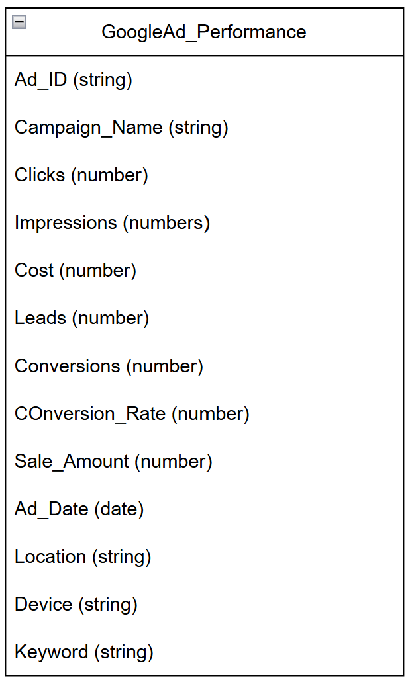
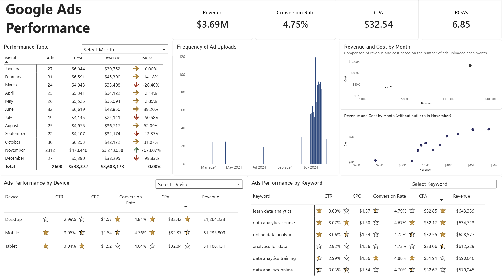

# Google Ads Performance Insights for Media Planning: Data Analytics Course - Hyderabad, 2024

### Project Background

A tech-education company specialising in online training to help people become professionals in the tech and data sectors. Founded in 2019 as a solution for those wishing to take courses but unable to attend face-to-face sessions due to the pandemic.

My role here is as a Marketing Analyst, responsible for evaluating the performance of marketing initiatives to inform the planning of future programmes. The marketing channel currently under evaluation is Google Ads, which has been in use from January to December 2024.

The Marketing Planning division requires insights into the performance of this marketing channel by answering the following questions.
1. How have the adverts performed and what results have they yielded for the company?
2. What steps should be taken to improve the performance of adverts on this channel?
2. Which aspects need to be optimised and evaluated?
3. Is it necessary to increase the advertising budget for this channel?

⚠️Disclaimer: This project does not represent a real-world scenario; it has been created for portfolio purposes.

### Data Structured

Ad performance data from Google Ads is available in a single table containing 13 columns and 2,660 rows. The data structure is as follows.

The raw data and the cleaned data can be viewed [here](https://github.com/CHodes-dev/GoogleAds-Performance-Analysis/blob/main/docs/googleads_performance_2024.xlsx). The data cleaning process is explained in this [file](https://github.com/CHodes-dev/GoogleAds-Performance-Analysis/blob/main/project_workflow/02_cleaning_data.md).

### Executive Summary

#### Overview

The company generated a total of $3.69 million from its marketing efforts on the Google Ads channel, with total costs of $538,372, recording a return on ad spend (ROAS) of 6.85 and a customer acquisition cost of $32.54. This means the company saw a return of up to six times its investment from these marketing efforts. However, it is not yet clear whether the customer acquisition cost remains within a safe range, as the profit margin, which is used as the standard for calculating net profit is unknown.

For a more detailed view of the ad performance, please refer to the dashboard below or download it [here](https://github.com/CHodes-dev/GoogleAds-Performance-Analysis/blob/main/docs/google_ads_performance.pbix).

#### Revenue Performance

The most striking performance in advertising revenue occurred in November and December. In November, there was a very significant increase in revenue of 7,673% from the previous month, reaching $3,278,058. Meanwhile, in the following month, revenue dropped by as much as 99% as only $38,295 was received. However, that month was not the worst. July was recorded as the month with the lowest revenue, amounting to just $24,141.

These three occurrences are also linked to fluctuations in costs incurred during those months. Meanwhile, the amount spent can be attributed to two factors: the frequency and the number of adverts uploaded each month. Following analysis, it appears that an increase in these indicators can boost advertising revenue.

#### Device and Keyword Performance

Generally, there are no significant differences in ad performance based on device or keywords. The following metrics can be assessed.

| Evaluation Metric	 | Dashboard	| Keyword |
| --- | --- | --- |
| CTR |	2.99% - 3.05%	| 2.92% - 3.09% |
| CPC |	$1.52 - $1.57 |	$1.50 - $1.57 |
| Conversion rate |	4.64% - 4.84%	 | 4.67% - 4.88% |
| CPA	 | $32.37 - $32.84 |	$31.91 - $32.85 |
| Revenue	| $1,188 M - $1,264 M |	$579K - $643K |

Therefore, the best course of action is to optimise and evaluate the aspects that highlight strengths and weaknesses based on these metrics.

- Optimising the performance of the main revenue drivers. Desktop devices and the keyword ‘learn data analytics’ are the largest contributors in their respective categories. This is because clicks on desktop ads are highly efficient, with the lowest acquisition cost ($32.42) and a high conversion rate (4.84%) Meanwhile, the use of the keyword ‘learn data analytics’ has a high acquisition cost ($32.85) but a relatively low conversion rate (4.79%).
- High potential to generate more revenue. Adverts accessed via mobile devices (the second-largest source of revenue) show a high level of effectiveness in attracting user traffic due to the high number of people clicking on the adverts (3.05%) at a relatively low acquisition cost ($32.84). However, the conversion rate remains average (4.76%).  
Meanwhile, the use of the keyword ‘data analytics course’ has a low customer acquisition cost ($32.17) but a low conversion rate (4.67%). On the other hand, the use of the keyword ‘data analytics training’ proves to be the most efficient, as its customer acquisition cost is the lowest ($31.92) whilst its conversion rate is the highest (4.88%).
- An evaluation is required to improve performance. Ad clicks from tablets and those using the keyword ‘analytics for data’ have the highest acquisition costs ($32.84) and ($33.07), yet their conversion rates are the lowest (4.64%) and (4.73%).
- Monitoring performance whilst maintaining ad quality. The use of the keywords ‘online data analytics’ and ‘data analytics online’ did not stand out in any particular aspect. The acquisition costs for both keywords were also at an average level ($32.55) and ($32.67), with conversion rates that were on the low side (4.72%) and (4.70%).

#### Recommendation

Based on the analysis carried out, the Media Planning division can take the following actions.

1. **Scheduling ad uploads** for more than one day per month, whilst also increasing the volume, has proven to boost revenue, as was the case in November, when the number of adverts was increased by 98.7% so revenue also rose sharply.

2. To recommend **improving the quality of the ad content** displayed to increase the number of clicks. This is because adverts displayed on **desktop** computers, which are the main contributor to revenue (accounting for 34.64% of total revenue) are generating a low number of clicks from users.

3. To recommend **improvements to website performance** and the **course registration process** for users. Adverts clicked on via **mobile** (contributing 33.51% of total revenue) have great potential to generate a significant increase in revenue, but their conversion rate remains low. The same applies to adverts appearing in response to the keywords ‘**data analytics course**’ (generated the second-highest revenue) and ‘**data analytics training**’ (generated the fifth-highest revenue) although these are highly cost-efficient, there are still too few people who ultimately end up registering for the course.  
The use of the keyword ‘**online data analytics**’ (generated the third-highest revenue) should also be noted, although it is not a priority for improvement, as it has successfully attracted a great deal of attention but still has a low conversion rate.

4. **Increase advertising spend**. Adverts triggered by the keyword ‘**data analytics training**’ (generated the fifth-highest revenue) are the most efficient in terms of spend and conversion rate compared to other keywords; therefore, increasing the budget for this type of advert has the potential to boost revenue.

5. **Evaluate advertising spend**. Ads displayed on **tablet** (contributing 32.21% of total revenue) have the highest user acquisition cost ($32.84) compared to users of other devices, whilst also having the lowest conversion rate. Similarly, the use of the keyword ‘**analytics for data**’ (which generated the fourth-highest revenue) has the highest user acquisition cost at $33.07, yet its conversion rate is relatively low.
