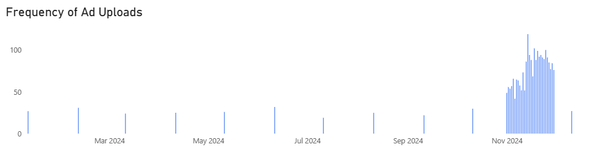
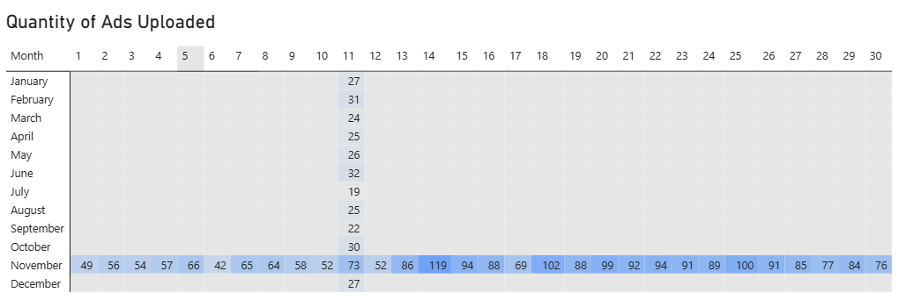
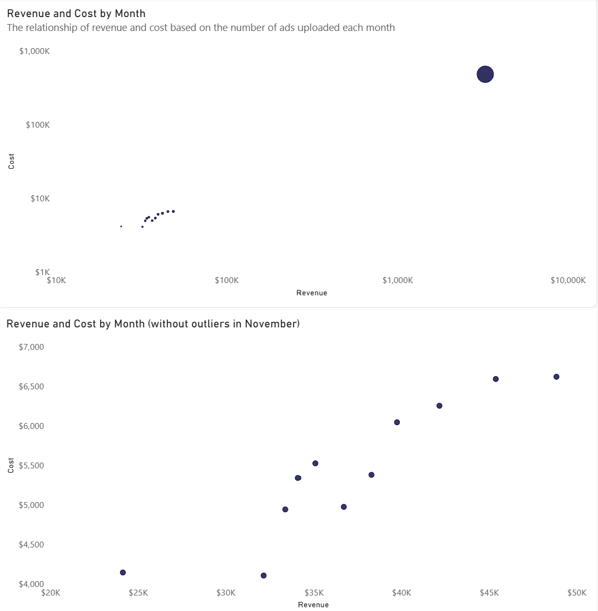

# In-depth Analysis

### Requirements Gathering

Objective of In-depth Analysis: To identify the causes of the increases and decreases in revenue that occurred in November and December 2024, and to determine whether there is a correlation between rising costs and the amount of revenue generated. A marketing funnel analysis was also carried out on devices and keywords to identify which adverts need to be optimised and which need to be evaluated.

**Augment the Data** 

At this stage, new metrics are added to assess ad performance, including:
- Cost per Click (CPC), the amount paid to get people to click on a website that appears on their search results page.
- Click-Through Rate (CTR), the percentage of people who end up clicking on an advert after it appears on their search results page.
- Cost per Acquisition (CPA), the amount required to get people to enrol on a course.

The key metric is Sale_Amount, whilst the metrics used for evaluation include Impressions, Clicks, CTR, CPC, Leads, Conversions, Conversion_rate and CPA. The dimensions used are Ad_date, Device and Keyword.

### In-depth Insight

| No.| Initial insight |
| --- | --- |
| 1 | Advertising costs in November were significantly higher than in previous months. They usually range from $4,000 to $6,000, but this month they rose 77-fold to $478,448. However, this increase in costs also led to a 78-fold rise in revenue. Average revenue in other months was only $37,283.18, whilst in November it rose to $3,278,058. |
| 2 | Following an increase in costs and revenue in November, both costs and revenue fell by 99% in December. Advertising costs fell sharply this month, with a reduction of $473,068. Consequently, revenue totalled just $38,295, down by at least $3.2 million from the previous month. |
| 3 | Revenue was at its lowest in July, totalling just $24,141. Advertising costs for that month were also among the lowest, at $4,145.

**Topic 1**: The reasons for the increase in advertising revenue and costs in November

The main reason for the 7,673.03% increase in advertising revenue in November was a significant rise in both the frequency and the number of adverts uploaded.

_Fig. 1 Frequency of ads uploaded graphic_

_Fig. 2 Quantity of ads uploaded graphic_

- Based on the frequency of ad uploads by the relevant division, in other months they typically upload several adverts at once in a single day, except in November, look at Fig. 1. The number of adverts uploaded in November accounted for as much as 88.92%, as adverts were uploaded every day throughout that month. 
- Furthermore, a difference is also evident in the number of adverts uploaded per day. See Fig. 2, by way of comparison, the number of adverts uploaded in months other than November ranged from 19 to 32. Meanwhile, in November alone, the number of adverts uploaded ranged from 42 to 119. 

**Topic 2**: The reasons for the significant drop in revenue in December

Following a significant increase in revenue in November, revenue fell sharply by 98.83% in December. This was due to the number of adverts posted during the month being significantly lower than in the previous month. The relevant division posted just 27 adverts in a single day throughout that month. As can be seen in Fig. 2.

**Topic 3**: The reason for the drop of revenue in July, making it the month with the lowest revenue performance

In July, when advertising revenue was at its lowest, the relevant division uploaded just 19 adverts per day that month as shown in Fig. 2. This figure was the lowest of all the months. It represented a 68% decrease from the number of adverts uploaded the previous month. This decline had a significant impact on advertising revenue for the month, with revenue falling by 58%.

**Topic 4**: The relationship between cost and revenue

Based on the three events that took place in July, November and December, the most significant factors were the number of advertisements, upload frequency, costs and revenue. These four indicators are interrelated. Within a single month, if the frequency of advertisement uploads increases, the number of advertisements uploaded also increases. An increase in the number of advertisements uploaded means higher costs will be incurred.  
Based on the Pearson correlation calculation carried out between monthly expenditure and revenue, a value of 0.999 was obtained. This result indicates a strong relationship between the two. This means that the higher the advertising expenditure in a given month, the higher the revenue generated.

_Fig. 3 Relationship between cost and revenue by month_

This is illustrated by the graph in Fig. 3. The further to the right the point moves indicating higher income, the higher it rises on the graph; conversely, the higher the income, the higher the costs incurred.

#### Device Performance

| No.| Initial insight |
| --- | --- |
| 1 | Generally, there is no significant difference in the revenue generated by customers using different devices to view adverts. Users who clicked on adverts via desktop devices contributed the most revenue, at 34.3%, equivalent to $1,264,233. Meanwhile, the lowest contribution came from users accessing adverts via tablet devices, at around 32.2%, equivalent to $1,188,131. The difference between the highest and lowest figures was only $76,102. |
| 2 | Similarly, there is no significant difference in the revenue generated by each keyword. The keyword that contributed the most to revenue, at 17.4%, was ‘learn data analytics’, amounting to $643,359. Meanwhile, the keyword that contributed the least was ‘data analytics online’, accounting for 15.7% or the equivalent of $579,245. The difference between the two was only $64,114. |

**Topic 1**: Ad performance evaluation metrics

The performance of the metrics used to measure the efficiency of adverts based on device and keyword usage is actually very similar, with no significant differences. Please refer to the table below.

| Evaluation Metric	| Dashboard |	Keyword |
| --- | --- | --- |
| CTR |	2.99% - 3.05% |	2.92% - 3.09% |
| CPC |	$1.52 - $1.57	| $1.50 - $1.57 |
| Conversion rate	| 4.64% - 4.84%	| 4.67% - 4.88% |
| CPA |	$32.37 - $32.84 |	$31.91 - $32.85 |

Therefore, what can be done is to optimise or evaluate the areas that show strengths or weaknesses based on the existing metrics.

**Topic 2**: Optimising the performance of the main revenue drivers

**Device: Desktop**

Ads accessed via desktop devices whether computers or laptops generated the highest revenue, totalling approximately $1,264,233, or 34.64% of total advertising revenue.

They have low costs and high conversion rates. Here are the metrics:
- CTR: 2.99% (low)
- CPC: $1.57 (highest)
- Conversion Rate: 4.84% (highest)
- CPA: $32.42 (cheapest)

Desktop users demonstrate the best traffic quality as they have the highest conversion rate and generate the greatest number of conversions. Although the CPC is the highest, desktop remains the most effective channel for generating revenue and should be prioritised for conversion-oriented advertising.

**Keyword: learn data analytics**

This keyword generated the highest revenue of $643,359, although  only its CTR was the highest; even its CPC was the most expensive, as can be seen below.
- CTR: 3.09% (highest)
- CPC: $1.57 (most expensive)
- Conversion Rate: 4.79% (average)
- CPA: $32.85 (expensive)

This top-performing keyword is not particularly efficient, as the CPC and CPA figures remain high whilst the conversion rate is still at a average level. The success of this keyword in generating revenue may be due to the high transaction values of those who have enrolled on the course.

The high CTR and CPA figures may be due to the very high cost of bidding on these keywords to reach the target audience. Many advertisers are competing to have their adverts appear on the first page of search results using the same keywords.

**Topic 3**: High potential to generate more revenue

**Device: Mobile**

Ads accessed via mobile are the second-largest source of revenue, accounting for 33.51% of total revenue, just 0.77% behind ads accessed via desktop.

The costs involved are not particularly high, whilst the number of clicks is the highest; note the following metrics.
- CTR: 3.05% (highest)
- CPC: $1.54 (average)
- Conversion Rate: 4.76% (average)
- CPA: $32.84 (cheap)

Mobile adverts are most effective at capturing users’ attention, as demonstrated by the highest CTR. However, the conversion rate is slightly lower than that for desktop, indicating that some mobile users do not proceed to the purchase or conversion stage.

Optimisation is required for website performance and the course registration process. An improvement in the conversion rate has the potential to generate a significant increase in revenue.

**Keyword: data analytics course and data analytics training**

The keyword ‘data analytics course’ generated the second-highest revenue, totalling $634,724, with low CPC and CPA costs. Note the following metrics.
- CTR: 3.07% (high)
- CPC: $1.50 (cheapest)
- Conversion Rate: 4.67% (lowest)
- CPA: $32.17 (lowest)

Ads for this keyword demonstrate high efficiency through low CPC and CPA values; although the conversion rate is the lowest, the revenue generated is still high. This high revenue may also be due to the high value of customer transactions, as is the case with the keyword ‘learn data analytics’.

The keyword ‘data analytics training’ generated the fifth-highest revenue, totalling $590,040, with the highest conversion rate and the lowest CPA.
- CTR: 2.99% (average)
- CPC: $1.56 (expensive)
- Conversion Rate: 4.88% (highest)
- CPA: $31.92 (cheapest)

Although it does not rank amongst the top three in terms of revenue, this keyword is the most efficient at converting clicks into conversions at the lowest acquisition cost. This keyword is a strong candidate for scaling the budget, as additional traffic has the potential to generate conversions more efficiently than other keywords.

**Topic 4**: Require evaluation to improve performance

**Device: Tablet**

Ads accessed via tablets generate the least revenue, accounting for 32.21% of total revenue.
- CTR: 3.04% (high)
- CPC: $1.52 (cheapest)
- Conversion Rate: 4.64% (lowest)
- CPA: $32.84 (most expensive)

Ads accessed via tablets generate clicks at the lowest cost; however, this advantage has not yet translated into conversions. This is evident from the conversion rate, which is the lowest compared to other devices. This suggests there are obstacles preventing people from signing up for courses. It is necessary to review the performance of the website as it appears on tablet devices.

**Keyword: analytics for data**

This keyword generated the fourth-highest revenue, totalling $612,229, but showed the weakest performance in terms of efficiency according to the metrics shown.
- CTR: 2.92% (lowest)
- CPC: $1.56 (expensive)
- Conversion Rate: 4.73% (low)
- CPA: $33.07 (most expensive)

The adverts triggered by this keyword are the least efficient because, whilst the costs incurred fall into the ‘expensive’ category, they generate relatively few sign-ups.

The low CTR and high CPC indicate that the adverts triggered by this keyword are not very popular and are mostly ignored by users, whilst the cost required to get these adverts clicked is high. The low conversion rate shows that few of those who clicked on the adverts decided to enrol on the course. It is important to check the content of adverts, both the headlines and the body text that appear when this keyword is used.

**Topic 5**: Monitoring performance while maintaining ad quality

**Keyword: online data analytic and data analytics online**

The keyword online data analytics generated the third-highest revenue, totalling $628,577, with a high CTR and an average CPC.
- CTR: 3.06% (high)
- CPC: $1.54 (average)
- Conversion Rate: 4.72% (low)
- CPA: $32.55 (medium)

Ads triggered by this keyword have successfully attracted a great deal of attention, as evidenced by the high CTR, which suggests that the ad content is popular with many people. The costs incurred are also not particularly high. However, the conversion rate remains relatively low. Not many people have gone on to sign up after clicking on the ads triggered by this keyword.

The keyword data analytics online generated the lowest revenue amongst other keywords, at $579,245, with a relatively low conversion rate.
- CTR: 3.03% (average)
- CPC: $1.54 (average)
- Conversion Rate: 4.70% (low)
- CPA: $32.67 (average)

Compared to other keywords, this keyword’s performance is the most stable, as the costs incurred are not particularly high, whilst the conversion rate is low but not the lowest. This keyword still has potential for performance improvement but is not a priority.

### Recommendation

Based on the analysis carried out, the Media Planning division can take the following actions.

1. **Scheduling ad uploads** for more than one day per month, whilst also increasing the volume, has proven to boost revenue, as was the case in November, when the number of adverts was increased by 98.7% so revenue also rose sharply.
   
2. To recommend **improving the quality of the ad** content displayed to increase the number of clicks. This is because adverts displayed on **desktop** computers, which are the main contributor to revenue (accounting for 34.64% of total revenue) are generating a low number of clicks from users.

3. To recommend **improvements to website performance** and the **course registration process** for users. Adverts clicked on via **mobile** (contributing 33.51% of total revenue) have great potential to generate a significant increase in revenue, but their conversion rate remains low. The same applies to adverts appearing in response to the keywords ‘**data analytics course**’ (generated the second-highest revenue) and ‘**data analytics training**’ (generated the fifth-highest revenue) although these are highly cost-efficient, there are still too few people who ultimately end up registering for the course. 
The use of the keyword ‘**online data analytics**’ (generated the third-highest revenue) should also be noted, although it is not a priority for improvement, as it has successfully attracted a great deal of attention but still has a low conversion rate.

4. **Increase advertising spend**. Adverts triggered by the keyword ‘**data analytics training**’ (generated the fifth-highest revenue) are the most efficient in terms of spend and conversion rate compared to other keywords; therefore, increasing the budget for this type of advert has the potential to boost revenue.

5. **Evaluate advertising spend**. Ads displayed on **tablet** (contributing 32.21% of total revenue) have the highest user acquisition cost ($32.84) compared to users of other devices, whilst also having the lowest conversion rate. Similarly, the use of the keyword ‘**analytics for data**’ (which generated the fourth-highest revenue) has the highest user acquisition cost at $33.07, yet its conversion rate is relatively low.
