# Explanatory Analysis

Explanatory analysis is the stage for explaining the reasons behind the patterns found, testing hypotheses, and proving cause and effect. 

### Requirements Gathering

The purpose of gathering requirements during this explanatory analysis phase is to ensure that the analysis achieves its established objectives and produces high-quality business recommendations. This explanatory analysis builds upon the previous analysis, in which each finding is examined in greater depth to identify its underlying causes. 

#### Purpose of the Analysis

To further analyze the findings from the exploratory analysis to identify the factors influencing the phenomenon. Additionally, an evaluation of ad performance is conducted to inform subsequent strategic decisions.

#### Metrics and Dimensions

This exploratory analysis focuses on cost performance, which includes expenses and revenue from marketing efforts through the Google Ads channel. Therefore, the metrics used in this analysis are Cost and Sale_Amount. The dimensions used are Ad_Date, Device, and Keyword. In addition to analyzing revenue performance in greater depth, this analysis also focuses on overall ad performance.

The metrics used are Cost, Sale_Amount, Impressions, Clicks, Leads, Conversions, and Conversion_Rate.

In addition to these metrics, additional metrics have been included to improve the quality of the analysis results and to serve as indicators for assessing ad efficiency. The added metrics are:
- CPC (Cost per Click), the amount paid to get people to click on an ad after it appears on their search results page. 
- CTR (Click-Through Rate), the percentage of people who end up clicking on an ad after it appears on their search results page. 
- CPA (Cost per Acquisition), the amount required to get a user to complete a conversion or transaction. 
- ROAS (Return on Ad Spend), the profit generated based on a comparison of ad spend and revenue.

#### Scope of Analysis

The desired outcome of this exploratory analysis phase is to identify actionable recommendations for improving ad performance on the Google Ads marketing channel. 

Therefore, the analysis should include the following: 
- Analyze the relationship between the increase in advertising expenses and the amount of revenue generated. 
- Analyze the reasons for the increase in revenue in November. 
- Analyze the causes of the drastic drop in revenue in December. 
- Analyze ad performance by device and keyword.

### Analysis Result

#### A. Ad Performance and Revenue

The table in the image below shows ad performance and revenue by month over the course of a year.

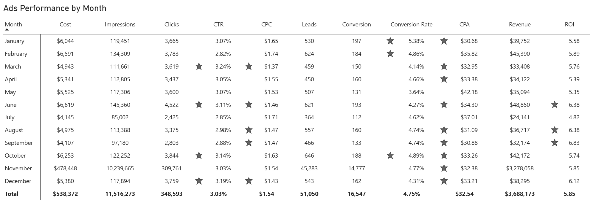
Fig. 1 Table of ad performance by month

1. Reasons for the Increase in Revenue in November

Ad performance during the Consideration stage in November was the strongest, particularly in terms of impressions and clicks. Impressions this month reached 10.2 million, with a total of 309,000 clicks. This stands in stark contrast to other months.

When analyzed based on the time ads were displayed and clicked, the results show that in November, ads were displayed and clicked more frequently each day and remained consistent throughout the month, as illustrated by the graph in Fig. 2 below.
 
The difference in the frequency of ads displayed and successfully clicked by users this month was as high as 88.9% compared to other months of the year.

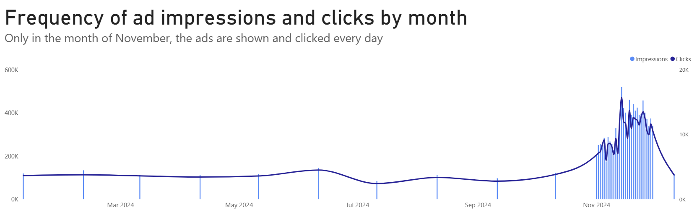
Fig. 2 Graph showing the frequency of ad impressions and clicks by month

Upon further examination of the number of clicks in that month, a significant difference becomes apparent. Note the graph in Fig. 3: the number of clicks in November increased dramatically, with some days reaching over 15,000 clicks (November 14). 
 
In comparison, other months only saw around 2,000 to 4,000 clicks per month. Meanwhile, even the lowest number of clicks—which occurred in November—reached approximately 6,000 clicks. That’s a very drastic difference. 

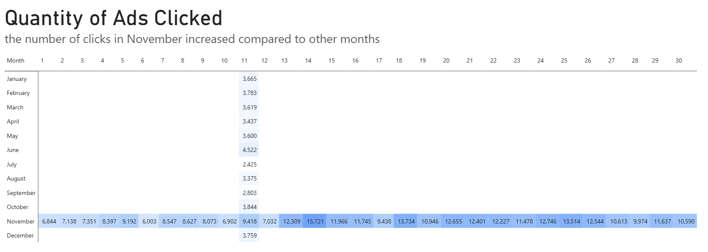
Fig. 3 Table showing the number of ad clicks by month

The increase in impressions and clicks this November is a very positive sign for generating more conversions, which in turn can lead to higher revenue.

This is evident from the number of leads generated from ad clicks this month, which was also the highest among all other months. While other months only generated between 300 and 600 leads, in November the number of leads rose to approximately 45,000.

The same is true for the number of conversions. This month, conversions reached 14,000 actions. This figure is vastly different from other months, which never exceeded 200 actions.

**What caused ad impressions to increase on Google Ads?**
 
The increase in ad impressions or the number of times an ad was displayed, this month may be due to higher ad spending for the month. This increase in spending amounted to 7,551% compared to the previous month.

Ad impressions occurring daily are driven by the availability of a daily advertising budget. The size of the daily advertising budget influences the number of ad impressions. The larger the daily budget, the more frequently ads are displayed on that day.

So, what happened in November was an increase in the frequency and daily cost of ads, which led to a rise in the number of impressions, making the ads appear more frequently on users’ search results pages and increasing the likelihood of clicks.

The more people who click on the ads, the more people successfully access the landing page. This means there’s a greater chance that more people will be interested in the services offered, ultimately leading to an increase in conversions.

This increase in conversions automatically boosts ad revenue for that month.

2. Reasons for the Significant Drop in Revenue in December

After experiencing a significant increase in revenue in November, revenue dropped sharply by 99% in December. This was due to a sharp decline in the number of page views and user clicks this month compared to the previous month.

The 99% drop in page views led to a decrease in clicks of more than 306,000.

Fewer people successfully reached the landing page, meaning there were fewer opportunities for potential transactions. This is evident from the number of leads, which totaled only 543 people, with a total of 162 conversions. This is a stark contrast to the previous month.

This is because the advertising budget in December dropped by as much as 99%. The advertising budget isn’t available every day, which means ads can’t be displayed daily.

No impressions mean no clicks and no conversions.

3. Why July Was the Month with the Lowest Revenue
 
Ad revenue in July totaled $24,141, down 51% from the previous month. The number of ad impressions and clicks this month was the lowest among all other months, only 8,000 impressions and 2,000 clicks.  
 
This resulted in a decrease in the number of people who ended up on the landing page and provided their contact information, which in turn caused a significant drop in conversions. There were only 112 conversions that month.  
 
The drop in impressions this month was due to the ad budget being among the lowest of the year. The ad budget for July was only $4,145, and it was spent in just one day throughout the entire month.

4. The relationship between expenses and revenue 
 
The trends observed from November through December and into July indicate that revenue is influenced by the amount of the advertising budget. 
 
Examine the graph in Fig. 4 showing the relationship between monthly income and monthly expenses. The data points shift further to the right as the values increase. This means that the higher the income, the higher the amount spent. For example, in November indicated by the red data point, the point is located farthest to the right and highest on the graph because the total income and expenses for that month were the highest.

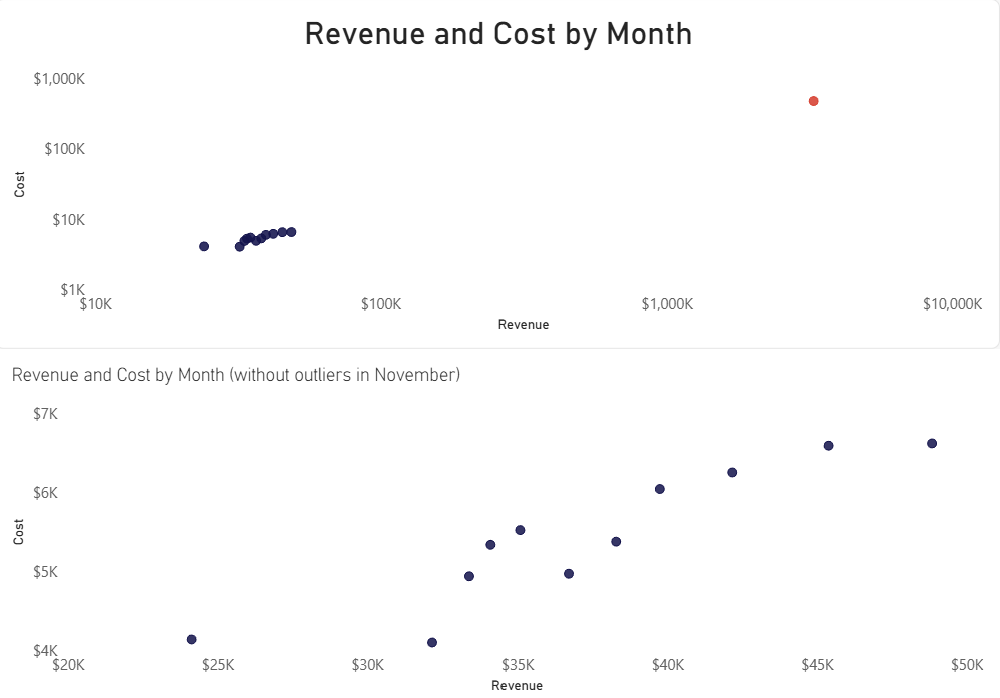
Fig. 4 Graph showing the relationship between income and budget by month 

Since it is well known that the amount of the budget spent is closely related to the amount of revenue generated, the next step is to identify the factors that lead to an increase in revenue. 
 
Based on the graph in Fig. 5, it can be seen that the budget amount can increase as the number and cost of ad bids placed on the Google Ads platform rise. These costs will ultimately influence the number of ad impressions based on the settings of Google’s ad system. The higher the bid, the greater the chance that the ad will appear on users’ search results pages.

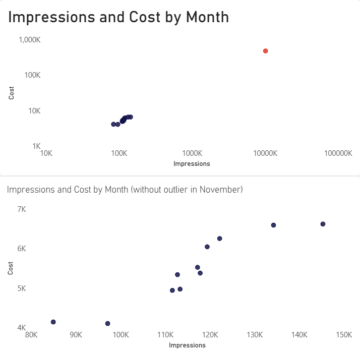
Fig. 5 Graph showing the relationship between the number of ad impressions and cost by month

A higher budget can increase revenue because it can boost the number of ad impressions. Consequently, an increase in ad impressions can lead to an increase in the number of clicks and other metrics as well.

#### B. Device and Keyword Performance

The following table shows ad performance based on device and keyword usage.

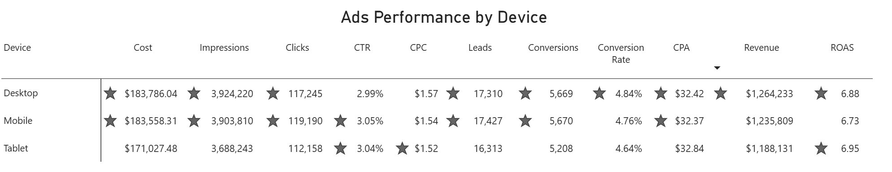
Fig. 6 Table showing ad performance by user device

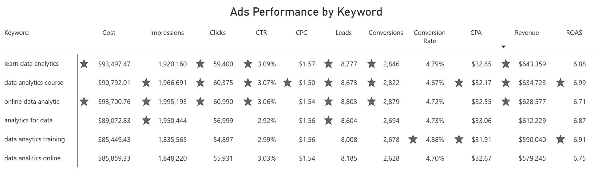
Fig. 7 Table of ad performance based on keyword usage

Figures 6 and 7 show that both the devices and keywords with the best performance have high total budgets, along with equally high numbers of impressions and clicks. This aligns with the results of the previous analysis: the more budget spent on increasing ad impressions, the greater the likelihood that revenue will also increase.

The nearly uniform ROAS figure, around 6, indicates that ads clicked on across various devices and keywords generate nearly the same revenue relative to the budget spent.

The performance of each device and keyword is actually very similar; there are no significant differences.

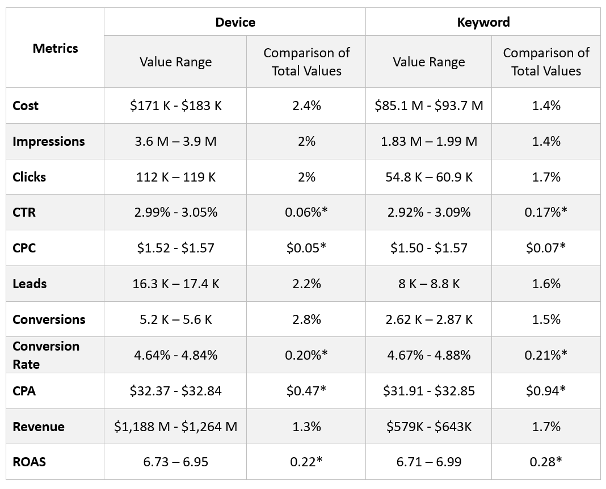
Note: (*) difference between the highest and lowest values

The differences in values across all metrics are less than 3% of the total value and less than $1 for CPC and CPA. In fact, revenue for the device category and keyword usage differ by only 1.3% and 1.7%, respectively—values too small to indicate the best or worst performance. 
 
However, in this analysis, we will still use the highest and lowest categories to refer to performance values when comparing across dimensions to simplify the analysis. 
 
The advantage of this small performance ratio is that even a slight improvement in metrics can directly impact ad revenue. 
 
Therefore, the following is a breakdown of ads by device and keywords, which serves as the basis for making advertising decisions.

1. Ads with the highest contribution to revenue

Device: **Desktop**

Ad performance when accessed via desktop devices is as follows.
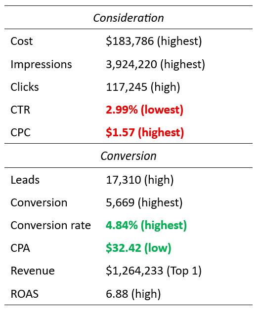

As the device that generates the most revenue, ads clicked on this device incur the highest costs, resulting in high impression and click counts. However, the growth in impressions is much faster than the growth in clicks, leading to a low CTR that is, the percentage of people who actually click on the ad. Therefore, it is necessary to increase the number of people clicking on ads via this device.

Because so many people end up clicking on ads and visiting the landing page, more leads are generated. This, in turn, boosts the conversion rate, bringing it to its highest level yet: 4.84%.

However, using this approach to attract users to the landing page is not efficient, as it results in the lowest click-through rate and the highest cost per click. Overall, though, this ad achieves an excellent conversion rate with a relatively low customer acquisition cost.  

One area where the performance of desktop ads needs improvement is in the “Consideration” stage. Therefore, irrelevant ad impressions should be reduced so that only audiences who truly have the potential to click on the ad are shown it. Once ad impressions are more targeted, it’s also necessary to increase the number of clicks by improving ad quality.

Keyword: **learn data analytics**

The ad performance triggered by the keyword “learn data analytics” is as follows.
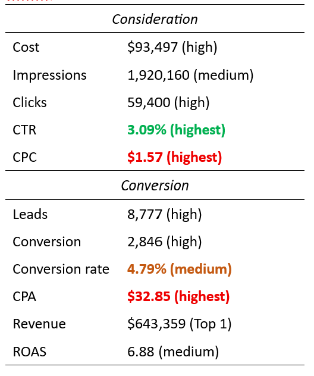

Ads displayed using this keyword require a high cost per impression; although the number of impressions isn’t particularly high, many people end up clicking on the ads, as evidenced by the highest CTR reaching 3.09%. 
 
Because of the high number of clicks, many people access the landing page, which ultimately generates leads. The number of conversions is relatively high, but the conversion rate after the ad is clicked is not particularly high. The high number of clicks is not matched by a corresponding number of conversions. Therefore, efforts to increase the number of conversions is still needed for this ad.
 
These keywords generate the highest revenue, but they aren’t efficient enough because both the cost per click and the acquisition cost are high, while the conversion rate isn’t high enough.

The high CPC may be due to intense competition for these keywords, driving up bid prices. Users searching for these keywords have high purchase potential, making them a target market for competitors as well. 
 
The number of impressions needs to be increased by raising the advertising budget for these keywords. The quality of the landing page also needs to be improved to boost the number of conversions by enhancing the quality of the offers on the landing page.

2. Ad performance that has the potential to increase revenue

Device: **Mobile**

Ad performance when accessed via mobile devices (Top 2 devices) is as follows.
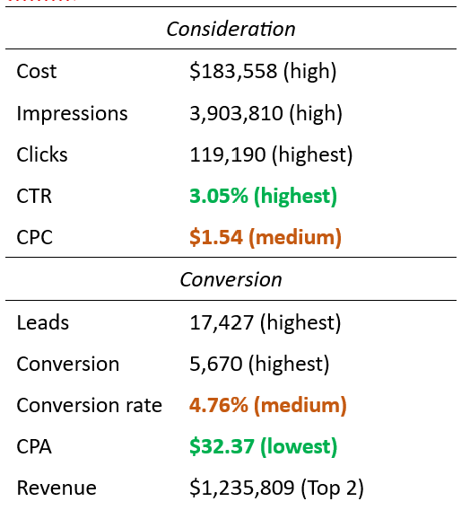

Ads clicked on mobile devices are the most effective at attracting people’s attention and driving them to the landing page, thanks to the high number of clicks and the highest CTR.

This type of ad also has actually very good conversion performance, as evidenced by the fact that it generates the highest number of leads and conversions. A conversion rate classified as “medium” is still not too bad in terms of numbers, since the difference from the highest conversion rate, which is achieved by desktop devices is only 0.08%. The low conversion rate is due to the fact that the growth in click volume is much greater than the growth in the number of conversions.

Therefore, it’s necessary to increase conversion rates by conducting a mobile landing page load speed audit. The landing page display on mobile devices needs to be examined to identify any issues users are experiencing that might be preventing them from completing a conversion.

Ads on mobile devices are among the most efficient due to their high click-through and conversion rates, coupled with relatively low advertising costs.

Therefore, improving the quality of landing pages on mobile devices to increase user conversions will likely lead to a corresponding increase in revenue from these ads.

Keyword: **data analytics course** and **data analytics training**

The ad performance driven by the keyword “data analytics course” (Top 2 keyword) is as follows.
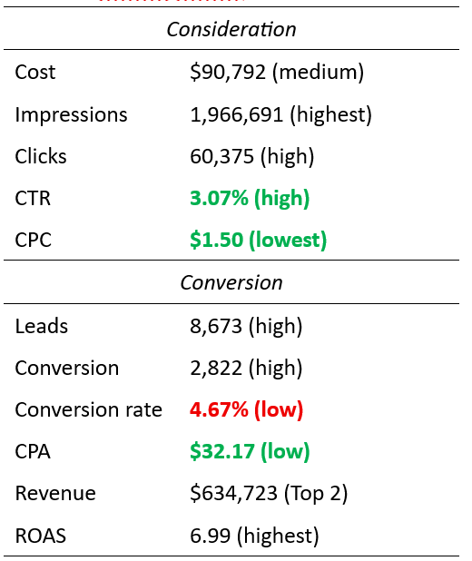

Ads triggered by the keyword “data analytics course” demonstrated strong relevance to the target audience, as evidenced by a decent number of clicks and a relatively high CTR. The number of leads and conversions generated from this keyword is also quite good; however, the low conversion rate is due to the higher volume of clicks compared to the number of conversions. 

Comparing the two makes the conversion rate appear low, even though the actual number of conversions and clicks is quite high. To increase the number of conversions for this keyword, you can align the ad copy with the landing page.

This type of ad is also the most efficient in terms of the number of clicks and conversions generated, which are quite high, while keeping costs low.

If you want to maximize the use of this keyword, you can do so by increasing the number of conversions through aligning your ad copy with the content on the landing page, so that your target audience perceives a strong relevance between what’s being offered and what they want.

The ad performance driven by the keyword “data analytics training” (Top 5 keyword) is as follows.
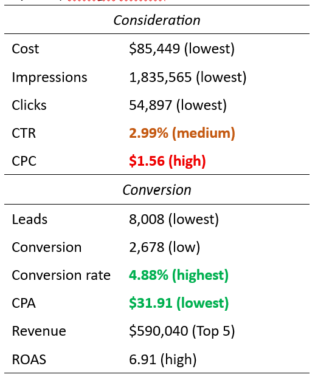

The use of this keyword results in the lowest cost, so the number of impressions and clicks obtained is also the lowest. Even so, the percentage of people who end up clicking on this ad is quite good, with a medium CTR.

Since the number of impressions and clicks is low from the start compared to other keywords, the number of leads and conversions also falls into the low range. However, in terms of conversion rate, ads triggered by this keyword are effective at driving conversions, resulting in the highest conversion rate.

The cost per click for this keyword is relatively high at $1.56, likely because many advertisers are also targeting users with this keyword. However, this ad is the most efficient because it has the lowest acquisition cost and the highest likelihood of generating conversions.

Increasing the ad budget for this keyword, given its best conversion rate at the lowest cost will further boost revenue.

3. Ad performance requiring evaluation

Device: **Tablet**

The performance of ads accessed via tablets (last-rank device) is as follows.
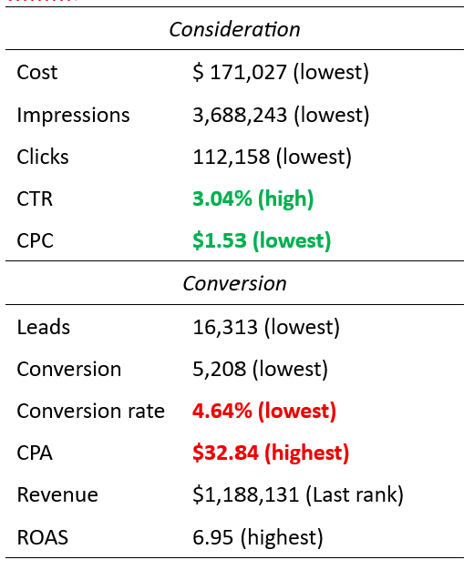

Ads displayed on tablets incur the lowest costs, so the number of impressions and clicks generated is also relatively low compared to users of other devices. However, users of on this device are the most likely to click on ads, as evidenced by a fairly high CTR of 3.04%.

As a result of the relatively low number of impressions and clicks, the number of leads and conversions was also low. The combination of low clicks and low conversions resulted in a conversion rate at its lowest level: only 4.64% of visitors to the landing page ultimately made a purchase.

Given the causes of this low conversion rate, it is necessary to improve both the number of clicks in the “Consideration” stage and the number of conversions in the “Conversion” stage.

These ads are relatively inexpensive to generate clicks but costly to acquire customers. The high cost, combined with a low conversion rate, makes ads clicked on tablets inefficient.

To increase revenue from these ads, an in-depth evaluation is needed regarding ad quality and user experience on the landing page when the ads are accessed via tablet.

Keyword: **analytics for data**

The ad performance driven by the keyword “analytics for data” (Top 4 keyword) is as follows.
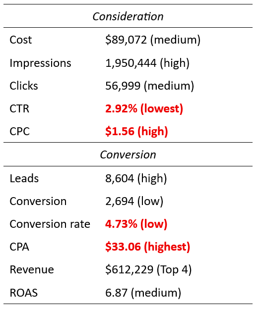

Users who entered the keyword “analytics for data” felt that the ads displayed did not sufficiently address their needs. This is evident from the high number of ad impressions but the relatively low number of clicks. As a result, the percentage of people who ended up clicking on the ad was among the lowest compared to other keywords.

Once users are on the landing page and have learned about the services offered, they are not interested in making a purchase, as evidenced by the low conversion rate of just 4.73%, the lowest among all keyword combinations.

The low percentage of people who end up clicking on the ads, the high cost required to get them to click, and the low conversion rate combined with high acquisition costs make ads using these keywords the least efficient.

The entire advertising process, from consideration to conversion needs to be reevaluated. The relevance of the ads and service offerings to users arriving via the keyword “analytics for data” needs to be improved.

By improving ad quality, revenue is likely to increase rapidly, as this type of ad is already generating fairly high revenue.

4. Ad performance that still needs to be monitored

Keywords: **online data analytics** and **data analytics online**

Ad performance driven by the use of the keyword “online data analytics” (Top 3 keyword) is as follows.
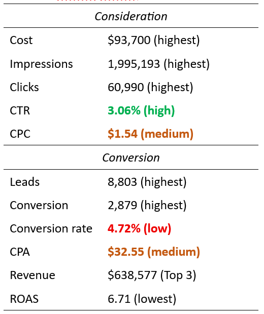

Ads triggered by the keyword “online data analytics” were the most expensive, resulting in the highest number of impressions and clicks. The number of people who ended up clicking on these ads was also the highest. This means users found the ads highly relevant to their interests, leading them to click on them.

The large number of people who ended up on the landing page resulted in a high number of leads and a higher conversion rate. It turns out that while the number of clicks made by users is high, the number of conversions is not as high, so the conversion rate is relatively low, at just 4.72%.

The cost required to get people to click on ads or to acquire users is not too high and remains at a moderate level. This type of ad is considered efficient. Ad performance has been quite good, as evidenced by the fact that revenue has placed among the top three. By increasing the number of conversions, revenue will also increase.

Ad performance driven by the keyword “data analytics online” (last-rank keyword) is as follows.
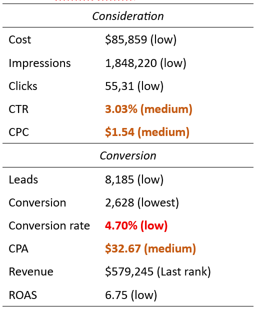

As the ad with the lowest budget, it’s fair to say that this keyword performs quite well in attracting users’ attention. Its CPC which isn’t particularly low indicates a high level of interest among users who see the ad after entering the keyword “online data analytics”.

However, the low budget has impacted the number of leads and conversions generated, resulting in a low conversion rate of just 4.70%.

Given that the number of clicks and conversions is relatively low and the cost is at a medium level, neither the lowest nor the highest, ads using this keyword are considered less efficient.

To improve ad efficiency, it is necessary to enhance the quality of ads to attract users through these keywords and evaluate the landing pages related to the services offered.
